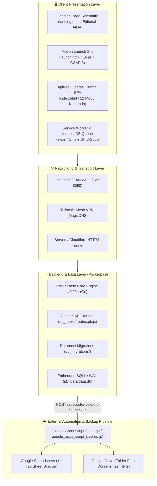
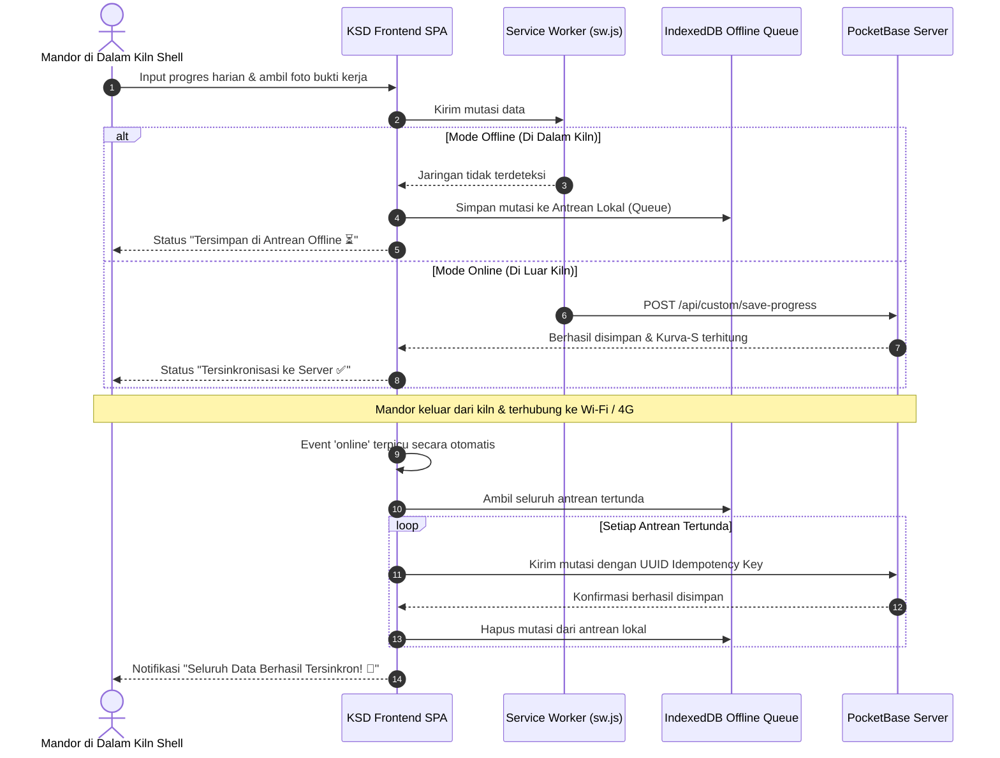

# KSD Monitor — Kiln Shutdown & Overhaul Management System

<div align="center">


-B8860B?style=for-the-badge&logo=go&logoColor=white)


**Platform Manajemen Presisi Tinggi untuk Operasional Shutdown, Overhaul, dan Pemasangan Refraktori Rotary Kiln Industri Semen.**
<br/>
*Designed & Developed by **Haysan Creative***

[Aplikasi Utama](index.html) • [Landing Page](landing.html) • [Motion Launch Site](launch.html) • [Arsitektur Teknis](docs/ARCHITECTURE.md) • [Buku Manual](docs/USER_MANUAL.md) • [Panduan Deployment](docs/DEPLOYMENT_GUIDE.md) • [Panduan Kontribusi](CONTRIBUTING.md) • [Media Showcase](showcase/README.md)

---

</div>

## 📑 Daftar Isi

1. [Ringkasan Eksekutif & Latar Belakang](#-ringkasan-eksekutif--latar-belakang)
2. [Arsitektur Sistem Terpadu](#-arsitektur-sistem-terpadu)
3. [Halaman Landing Sinematik (`landing.html`)](#-halaman-landing-sinematik-landinghtml)
4. [Motion Launch Site Interaktif (`launch.html`)](#-motion-launch-site-interaktif-launchhtml)
5. [Fitur & Modul Operasional Lengkap](#-fitur--modul-operasional-lengkap)
   - 01. Dashboard Eksekutif & Telemetri Proyek
   - 02. Engine Kurva-S (S-Curve) Real-time
   - 03. Master Jobdesk IAC & Sub-Jobdesk
   - 04. Entri Progres Lapangan & Anti-Miskeying Guard
   - 05. Validasi Mutu & Dokumentasi Foto 3-Tahap
   - 06. Antrean Persetujuan (Approval Gate Workflow)
   - 07. Kalkulator Presisi Refraktori & Pengujian Castable
   - 08. Logistik Material (Issue, Consumed, Return, Shortage)
   - 09. Manpower & Jam Kerja Efektif Kontraktor
   - 10. Kalender Proyek, Critical Path & Milestone
   - 11. Pusat Laporan Resmi & 1-Klik Ekspor Dokumen
   - 12. Pengaturan Proyek, Baseline & Lessons Learned
6. [Keamanan, Multi-Tenant & Hirarki Peran (RBAC)](#-keamanan-multi-tenant--hirarki-peran-rbac)
7. [Arsitektur Offline-First PWA & Sinkronisasi Blind-Spot](#-arsitektur-offline-first-pwa--sinkronisasi-blind-spot)
8. [Mesin Grafis Gerak Terprogram (Remotion) & Media Showcase](#-mesin-grafis-gerak-terprogram-remotion--media-showcase)
9. [Otomasi Cloud Backup ke Google Spreadsheet & Drive](#-otomasi-cloud-backup-ke-google-spreadsheet--drive)
10. [Struktur Direktori Repositori](#-struktur-direktori-repositori)
11. [Panduan Instalasi & Menjalankan Sistem](#-panduan-instalasi--menjalankan-sistem)
12. [Metode Akses Multi-Device (LAN, Tailscale, Publik HTTPS)](#-metode-akses-multi-device)
13. [Daftar Endpoint Kustom Backend (`pb_hooks`)](#-daftar-endpoint-kustom-backend)
14. [Design System & Panduan Tipografi](#-design-system--panduan-tipografi)
15. [Automated CI & Jaminan Mutu Repositori](#-automated-ci--jaminan-mutu-repositori)
16. [Dokumentasi Lengkap & Tautan Terkait](#-dokumentasi-lengkap--tautan-terkait)
17. [Lisensi & Hak Cipta](#-lisensi--hak-cipta)

---

## 🏭 Ringkasan Eksekutif & Latar Belakang

Operasional pemeliharaan besar (*major overhaul*) dan *shutdown* rotary kiln di industri semen menuntut kecepatan, kepatuhan keselamatan ekstrem, dan akurasi pemasangan bata tahan api (*refractory bricking*) serta *castable* hingga hitungan milimeter. Keterlambatan hitungan jam pada fase *cooling down*, *demolition*, hingga *firing restart* dapat menimbulkan kerugian *downtime* fasilitas senilai ratusan juta rupiah per hari.

Sebelum adanya **KSD Monitor**, tim lapangan menghadapi masalah kritis:
- **Penyebaran Data yang Tercecer**: Laporan progres dan kendala mandor terserak di grup WhatsApp, buku saku fisik, dan kertas catatan yang rentan hilang saat pergantian *shift*.
- **Kerusakan Formula Spreadsheet**: Rumus bobot bobol tertimpa tidak sengaja, kalkulasi Kurva-S meleset, serta entri keliru (>100% atau salah ketik huruf pada kolom kuantitas).
- **Kurangnya Bukti Otentik Mutu**: Tidak adanya arsip foto terstruktur sebelum pembongkaran (*tearing*), saat pemasangan cincin bata, dan saat penguncian hidrolik (*key jack*).
- **Ketergantungan Sinyal Radio di Dalam Silinder Kiln**: Area kerja di dalam cangkang baja (*kiln shell*) merupakan zona tanpa sinyal (blind spot), menyebabkan aplikasi web konvensional gagal menyimpan data.

**KSD Monitor (Kiln Shutdown Dashboard)** hadir sebagai platform operasi komando tunggal yang menggabungkan keandalan **PocketBase (Go/SQLite)**, arsitektur **Offline-First PWA**, mesin validasi ketat (*Strict Anti-Miskeying Engine*), dan bahasa visual modern berstandar industri presisi tinggi.

---

## 🏗️ Arsitektur Sistem Terpadu

Sistem dirancang modular, ringan (*zero heavyweight npm builds* pada antarmuka), dan mampu beroperasi mandiri tanpa dependensi cloud berbayar:



*(Spesifikasi teknis mendalam dan diagram relasi data dapat dibaca pada [docs/ARCHITECTURE.md](docs/ARCHITECTURE.md)).*

---

## 🎨 Halaman Landing Sinematik (`landing.html`)

Landing page KSD Monitor diakses pada [`landing.html`](landing.html) (tersedia live di `http://localhost:8090/landing.html`), dirancang dengan prinsip estetika tinggi, tata letak berbingkai (*framed shell*), dan interaktivitas panggung kendali modular:

### 1. Karakteristik Desain Panggung Utama
- **Framed Canvas Shell**: Viewport dibungkus frame putih bersih (`padding: 12px; background: var(--paper)`), membingkai panggung seperti karya seni galeri modern.
- **Top Promo Countdown Bar**: Bilah status di atas hero yang menampilkan sequence overhaul (*"D-09 / 14 HARI · 120H 00M 32S MENUJU FIRING"*) dengan counter detik yang berdetak *real-time*.
- **Deep Ocean Hero Card**: Kartu hero berdimensi penuh dengan sudut lengkung halus (`border-radius: 16px; background: linear-gradient(180deg, #0D1B2A, #070D14)`), scrim gradient bawah, dan tipografi editorial rapat (`Inter Tight`, `letter-spacing: -0.04em`).
- **Floating Mode Switcher Dock**: Dermaga vertikal di sisi kanan hero dengan 4 tombol mode (Kurva-S, Foto QC, Kalkulator Tonase, Matriks Dispatch).
- **Sliding Secondary Frosted Glass Pill Navbar**: Navbar kapsul melayang (`backdrop-filter: blur(28px)`) yang meluncur turun dari atas layar saat pengguna menggulir melewati hero.

### 2. Kursor Interaktif & Efek Grunge Film Grain
- **Dual-Layer Custom Cursor Reticle**: Titik pusat presisi berwarna *flame amber* (`.custom-cursor-dot`) dengan cincin bidik HUD luar berkecepatan *lerp* fisik (`.custom-cursor-ring`).
- **Procedural Film Grain Canvas (`#grungeGrainCanvas`)**: Menghasilkan butiran film 35mm prosedural pada ~16fps tanpa lag GPU/CPU, dipadu dengan *Cinema Spotlight* yang mengikuti koordinat kursor pengguna.

### 3. Narasi 5 Babak Storytelling (AIDA Architecture)
- **Prolog (Hero Shell & Mode Dock)**: Penegasan proposisi nilai dengan CTA ganda.
- **Babak I (Realita Lapangan)**: 3 kartu *pain points* (Data tercecer di WhatsApp, Human error salah ketik rumus, Keterlambatan firing tak terdeteksi).
- **Babak II (Panggung Komando Interaktif)**: Tab navigator teknis dan simulasi kalkulasi.
- **Babak III (Sistem Mosaic / Asymmetric Bento Grid)**: Kapabilitas PWA offline-first dan kalkulasi delta waktu nyata.
- **Babak IV (Suara Lapangan)**: Testimoni autentik praktisi kiln overhaul.
- **Babak V (Epilog CTA) & Minimalist Footer**: Penutup berdaya konversi tinggi.

---

## 🚀 Motion Launch Site Interaktif (`launch.html`)

Selain landing page editorial, KSD Monitor menghadirkan **Motion Launch Site Sinematik** pada [`launch.html`](launch.html) (tersedia live di `http://localhost:8090/launch.html`).

### Sorotan Teknologi Motion Launch:
- **Lenis Smooth Scroll v1.1.18**: Gulir halaman berbasis akselerasi fisik inersia cairan yang mulus di seluruh browser desktop dan seluler.
- **GSAP 3 & ScrollTrigger Pinning**: Animasi scrubbing bertahap, efek penguncian panggung (*pinning*), dan paralaks kedalaman optik 3D.
- **Atmospheric Soundscape (55Hz Kiln Hum)**: Kontrol audio terintegrasi yang mensimulasikan dengungan frekuensi rendah putaran silinder rotary kiln.
- **Canvas Confetti Particle Burst**: Efek letupan partikel perayaan saat pengguna menekan tombol luncur panggung komando.
- **Industrial Cyber-Precision Styling**: Desain bertema *Deep Cyber Void* (`#05080E`), aksen *Flame Amber* (`#F59E0B`), dan pembatas garis kisi teknis yang tajam.

---

## 🛠️ Fitur & Modul Operasional Lengkap

Aplikasi utama KSD Monitor ([`index.html`](index.html)) memuat 12 modul komando operasional:

### 01. Dashboard Eksekutif & Ringkasan KPI (`#view-dashboard`)
Ringkasan metrik proyek tingkat tinggi: Progres Aktual vs Rencana, Indeks Kinerja Jadwal (SPI), countdown menuju fase *firing restart*, status konsumsi material refraktori, dan matriks dispatch personil kontraktor.

### 02. Engine Kurva-S (S-Curve) Real-time (`#view-scurve`)
Visualisasi Kurva-S interaktif berbasis **Chart.js** dengan trajektori *Sigmoid Curve*. Menampilkan kurva rencana awal (*baseline schedule*), capaian aktual kumulatif tervalidasi, serta kalkulasi deviasi otomatis (*Ahead of Schedule* / *Critical Delay*).

### 03. Master Jobdesk IAC & Sub-Jobdesk (`#view-jobdesk`)
Pengaturan struktur pekerjaan hierarkis: Item Aktivitas Center (IAC) induk dengan faktor bobot persentase otomatis dan sub-jobdesk rincian teknis per zona silinder (Burning Zone, Transition Zone, Safety Zone).

### 04. Entri Progres Lapangan & Anti-Miskeying Guard (`#view-input-progress`)
Formulir input lapangan dengan pengaman salah ketik (*Anti-Miskeying Guard*): batas maksimum absolut 100%, penguncian karakter non-numerik, slider taktil persentase, dan deteksi anomali lonjakan progres mendadak.

### 05. Validasi Mutu & Dokumentasi Foto 3-Tahap (`#view-validations`)
Pipa pengawasan mutu wajib dalam 3 fase mutlak:
1. `Before`: Foto kondisi bata lama sebelum dibongkar (*demolition*).
2. `During`: Foto proses penyusunan ring bata dan celah ekspansi pelat baja.
3. `After`: Foto hasil penguncian hidrolik akhir (*key jack*) dan plat penahan.

### 06. Antrean Persetujuan (Approval Gate Workflow) (`#view-approval`)
Pintu otorisasi pengawas: Setiap entri mandor masuk ke antrean pending. Pengawas internal berwenang menyetujui (*Approve*) untuk mengunci progres ke Kurva-S, atau menolak (*Reject*) disertai catatan teknis perbaikan.

### 07. Kalkulator Presisi Refraktori & Pengujian Castable (`#view-castable`)
Kalkulator matematis terintegrasi untuk menghitung volume m³, tonase kebutuhan bata tahan api, jumlah zak semen perekat, dan pencatatan hasil pengujian densitas castable.

### 08. Logistik Material Refraktori (`#view-materials`)
Pelacakan inventaris material: Kuantitas Rencana (Plan), Diterbitkan (Issued), Terpakai (Consumed), dan Sisa Retur (Return) dengan kalkulasi otomatis selisih/shortage.

### 09. Manpower & Jam Kerja Efektif Kontraktor (`#view-manpower`)
Pemantauan kehadiran personil lapangan per kontraktor (PT), shift kerja harian, dan akumulasi jam kerja efektif (*Man-Hours*).

### 10. Kalender Proyek, Critical Path & Milestone (`#view-calendar`)
Gantt Chart interaktif dan penandaan jalur kritis (*Critical Path*) yang menyoroti aktivitas berisiko memicu kemunduran jadwal *firing*.

### 11. Pusat Laporan Resmi & 1-Klik Ekspor Dokumen (`#view-reports`)
Penghasil dokumen otomatis format PDF Executive Brief dan lembar kerja Excel audit serah terima pekerjaan.

### 12. Pengaturan Proyek, Baseline & Lessons Learned (`#view-settings`)
Manajemen baseline jadwal, pembatasan hak akses pengguna, konfigurasi unit kiln, dan modul rekam jejak *Lessons Learned* pasca-overhaul.

---

## 🔐 Keamanan, Multi-Tenant & Hirarki Peran (RBAC)

KSD Monitor menerapkan isolasi multi-tenant dengan pembagian hak akses terperinci:

| Peran (Role) | Hak Akses Modul | Batasan Operasional |
| :--- | :--- | :--- |
| **Super Admin** | Akses Penuh (12 Modul) | Konfigurasi sistem, manajemen akun pengguna, reset database, ekspor backup penuh |
| **Kiln Superintendent** | Dashboard, Kurva-S, Jobdesk, Laporan, Approval | Mengunci baseline, otorisasi final persetujuan, memantau seluruh kontraktor |
| **Contractor Mandor** | Lapor Progres, Unggah Foto, Log Material/Manpower | Hanya dapat menginput jobdesk di bawah naungan PT masing-masing |
| **Third-Party QC Inspector** | Persetujuan Mutu, Pengujian Castable, Audit Foto | Memverifikasi foto Before/During/After, memberikan catatan teknis inspeksi |

---

## 📱 Arsitektur Offline-First PWA & Sinkronisasi Blind-Spot

Area kerja di dalam cangkang baja (*kiln shell*) adalah sangkar Faraday yang memblokir sinyal seluler dan Wi-Fi. KSD Monitor dirancang agar **tetap dapat digunakan 100% tanpa jaringan**:



---

## 🎬 Mesin Grafis Gerak Terprogram (Remotion) & Media Showcase

Repositori ini memadukan kode sumber aplikasi dengan sistem grafis gerak sinematik berbasis kode (*programmatic video generation*) pada folder [`video/`](video/) dan katalog media pada [`showcase/`](showcase/README.md).

### 1. Video Teaser Peluncuran Siap Pakai:
- **Lanskap 16:9**: [`showcase/teaser-landscape/brag.mp4`](showcase/teaser-landscape/brag.mp4) (Resolusi 1920×1080 untuk presentasi layar lebar dan desktop).
- **Potret 9:16**: [`showcase/teaser-vertical/brag.mp4`](showcase/teaser-vertical/brag.mp4) (Resolusi 1080×1920 untuk Instagram Reels, TikTok, YouTube Shorts).

### 2. Komposisi Remotion Video (`video/src/compositions/`):
- `TrunovaLaunch16x9`: Video promosi komprehensif 60 detik lanskap.
- `TrunovaLaunch9x16`: Video promosi vertikal seluler.
- `TrunovaAdminTeaserDesktop`: Teaser desktop showcase 20 detik.
- `TrunovaDesktopToMobileTransition`: Transisi responsif konsol kendali ke aplikasi mobile.

```bash
# Menjalankan studio Remotion:
cd video
npm run preview

# Render video:
npm run render:teaser
```

---

## ☁️ Otomasi Cloud Backup ke Google Spreadsheet & Drive

Sistem dilengkapi pipa integrasi mandiri menggunakan **Google Apps Script** ([`code.gs`](code.gs) dan [`google_apps_script_backup.js`](google_apps_script_backup.js)) yang secara periodik mencadangkan seluruh data dan foto ke cloud Google tanpa biaya langganan:

1. **Endpoint Ekspor Lengkap**: PocketBase menyediakan endpoint aman `POST /api/custom/export-full-backup` yang merangkum seluruh tabel database dalam satu payload JSON.
2. **11 Tab Sheet Sinkron Otomatis**: `Proyek_KSD`, `Struktur_IAC`, `Sub_Jobdesk`, `Laporan_Harian`, `Validasi_Progres`, `Log_Material`, `Log_Manpower`, `Daftar_Kontraktor`, `Daftar_Pengguna`, `Inspeksi_Castable`, dan `Riwayat_Backup`.
3. **Ekstraksi File Foto Asli ke Google Drive**: Setiap foto yang dilampirkan diekstrak otomatis menjadi berkas fisik `.jpg` di Google Drive pada folder **`KSD_Dokumentasi_Foto_Backup`**, lalu tautan langsungnya disematkan ke baris spreadsheet terkait.
4. Panduan konfigurasi rinci tercantum di [PANDUAN_BACKUP_GOOGLE_SPREADSHEET.md](PANDUAN_BACKUP_GOOGLE_SPREADSHEET.md).

---

## 📂 Struktur Direktori Repositori

```text
/Users/haysan/Documents/KSD file/
├── 📄 index.html                           # Aplikasi Operasi Utama SPA (~12.000 baris, 12 modul komando)
├── 📄 landing.html                         # Halaman Landing Sinematik (AIDA Storytelling Architecture)
├── 📄 launch.html                          # Motion Launch Site Sinematik (Lenis + GSAP 3 Physics)
├── 📄 manifest.webmanifest                 # Konfigurasi PWA (Icons, Theme Color, Display Standalone)
├── 📄 sw.js                                # Service Worker PWA (Offline Caching & Network-First)
├── 📄 Picture1.svg                         # 🚨 Master Vector Source (IMMUTABLE BRAND INVARIANT)
├── 📄 start_local.sh                       # Script Shell Menjalankan Server Lokal PocketBase (Port 8090)
├── 📄 stop_local.sh                        # Script Shell Mematikan Proses Server Lokal
├── 📄 google_apps_script_backup.js         # Script Google Apps Script untuk Backup ke Spreadsheet & Drive
├── 📄 code.gs                              # Script Google Apps Script Terintegrasi
├── 📄 README.md                            # Dokumentasi Komprehensif Sistem (Dokumen Ini)
├── 📄 CONTRIBUTING.md                      # Panduan Kontribusi & Standar Mutu Kode
├── 📄 CHANGELOG.md                         # Riwayat Pembaruan dan Patch Catatan Rilis Engine
├── 📄 LICENSE.md                           # Lisensi Hak Penggunaan Sistem
├── 📄 PANDUAN_BACKUP_GOOGLE_SPREADSHEET.md # Panduan Detail Konfigurasi Ekstensi Google Apps Script
│
├── 📁 .github/                             # Standar Kolaborasi & Otomasi GitHub
│   ├── 📁 workflows/                       # CI Pipeline (Validasi HTML, Proteksi Brand, Mirroring)
│   │   └── 📄 ci.yml
│   ├── 📁 ISSUE_TEMPLATE/                  # Formulir Pelaporan Bug & Usulan Fitur
│   │   ├── 📄 bug_report.md
│   │   └── 📄 feature_request.md
│   └── 📄 PULL_REQUEST_TEMPLATE.md         # Template Standarisasi Pengajuan Pull Request
│
├── 📁 docs/                                # Pusat Dokumentasi Mendalam
│   ├── 📄 ARCHITECTURE.md                  # Spesifikasi Teknis, Skema Database, & S-Curve Formula
│   ├── 📄 DEPLOYMENT_GUIDE.md              # Panduan Deployment (Local, Wi-Fi LAN, Tailscale, Cloudflare)
│   ├── 📄 USER_MANUAL.md                   # Buku Manual Pengguna untuk Mandor, QC, & Superintendent
│   └── 📁 archive/                         # Arsip Historis Prototipe Awal
│       └── 📁 legacy-appscript/            # Snapshot Kode Gudang Kiln Google Apps Script
│           ├── 📄 code.gs.txt
│           ├── 📄 index.html.txt
│           └── 📄 README.md
│
├── 📁 showcase/                            # Media Promosi & Video Teaser Peluncuran
│   ├── 📄 README.md                        # Katalog Media & Spesifikasi Video
│   ├── 📁 teaser-landscape/                # Video Teaser Format Lanskap 16:9 (brag.mp4, brag.jpg)
│   └── 📁 teaser-vertical/                 # Video Teaser Format Potret 9:16 (brag.mp4, brag.jpg)
│
├── 📁 video/                               # Mesin Video Gerak Terprogram (Remotion React Engine)
│   ├── 📄 package.json                     # Konfigurasi Dependensi Remotion 4.0
│   ├── 📄 remotion.config.ts               # Konfigurasi Rendering Remotion
│   ├── 📄 tsconfig.json                    # Konfigurasi TypeScript
│   ├── 📁 src/                             # Komposisi Video (16:9, 9:16, Teaser Desktop)
│   └── 📁 public/                          # Aset Audio & Media Grafis Remotion
│
├── 📁 pb_data/                             # Database Penyimpanan Fisik PocketBase (SQLite WAL)
│   ├── 📄 data.db                          # Basis Data Utama SQLite
│   ├── 📄 auxiliary.db                     # Basis Data Log & Internal PocketBase
│   └── 📄 types.d.ts                       # Definisi Tipe Data Schema
│
├── 📁 pb_hooks/                            # Logika Bisnis Kustom Backend (PocketBase JavaScript Engine)
│   ├── 📄 routes.pb.js                     # Endpoint REST API Kustom (Multi-Tenant, Kurva-S, Validasi)
│   ├── 📄 seed.pb.js                       # Generator Data Dummy Proyek & Pengguna
│   └── 📄 utils.js                         # Utilitas Helper Backend
│
├── 📁 pb_migrations/                       # Skema Basis Data & Migrasi Terkontrol
│   ├── 📄 1723120000_init_ksd.js           # Migrasi Inisialisasi Koleksi KSD
│   └── 📄 1723200000_multi_tenant.js       # Migrasi Dukungan Multi-Tenant
│
├── 📁 pb_public/                           # Webroot Publik yang Disajikan Otomatis oleh PocketBase
│   ├── 📄 index.html                       # Mirroring Aplikasi Operasi Utama SPA
│   ├── 📄 landing.html                     # Mirroring Landing Page Sinematik
│   ├── 📄 launch.html                      # Mirroring Motion Launch Site Sinematik
│   ├── 📄 sw.js                            # Mirroring Service Worker PWA
│   ├── 📄 manifest.webmanifest             # Mirroring Manifest PWA
│   ├── 📁 assets/                          # Mirroring Aset Gambar & Video
│   └── 📁 icons/                           # Mirroring Ikon PWA & Favicon
│
├── 📁 assets/                              # Aset Statis Repositori
│   ├── 📁 branding/                        # Logo Resmi, Supergraphics, Monogram, Panduan Identitas
│   ├── 📄 hero-kiln.mp4                    # Video Latar Belakang Hero Kiln
│   └── 📄 audit-*.jpg / *.png              # Dokumentasi Foto Sampel Audit Mutu
│
├── 📁 icons/                               # Koleksi Ikon Web App PWA & Favicon
├── ⚙️ pocketbase                           # Binary Eksekusi Server PocketBase (macOS / Linux)
└── 📁 .agents/                             # Spesifikasi AI Agents, Aturan Kerja, & Skills
```

---

## 💻 Panduan Instalasi & Menjalankan Sistem

### Prasyarat Sistem:
- Sistem Operasi: macOS, Linux, atau Windows (via WSL2).
- Ruang Disk: Minimum 100 MB.
- Dependensi: **Zero External Dependencies** (PocketBase adalah *self-contained executable binary*).

### 1. Menjalankan Server Menggunakan Script Cepat
```bash
# Berikan izin eksekusi skrip (hanya sekali):
chmod +x start_local.sh stop_local.sh pocketbase

# Jalankan server KSD Monitor:
./start_local.sh
```

### 2. Mematikan Server
```bash
./stop_local.sh
```

### 3. Menjalankan Server Secara Manual via CLI
```bash
./pocketbase serve --http="0.0.0.0:8090"
```

---

## 🌐 Metode Akses Multi-Device

```text
┌─────────────────────────────────────────────────────────────────────────┐
│                        METODE AKSES KSD MONITOR                         │
├──────────────────┬─────────────────────────────┬────────────────────────┤
│ METODE           │ ALAMAT URL                  │ KETERANGAN             │
├──────────────────┼─────────────────────────────┼────────────────────────┤
│ Host Lokal       │ http://localhost:8090/      │ Komputer Server        │
│ Landing Page     │ http://localhost:8090/landing.html │ Master Island Navbar │
│ Motion Launch    │ http://localhost:8090/launch.html  │ Cinematic Physics   │
│ Wi-Fi Intranet   │ http://192.168.1.5:8090/    │ HP/Tablet di Ruang CCR │
│ Tailscale Mesh   │ http://100.99.188.113:8090/ │ VPN Privat Antar-Kota  │
│ MagicDNS         │ http://ksd-monitor.tail76fff5.ts.net/ │ Domain VPN   │
│ Cloudflare HTTPS │ https://firewall-designated-preview-crowd.trycloudflare.com/ │ Akses Publik Global │
└──────────────────┴─────────────────────────────┴────────────────────────┘
```

---

## 🔌 Daftar Endpoint Kustom Backend (`pb_hooks/routes.pb.js`)

PocketBase diperkaya dengan kumpulan endpoint kustom untuk menangani logika bisnis khusus:

| Method | Endpoint Path | Keterangan & Fungsionalitas |
| :--- | :--- | :--- |
| `POST` | `/api/custom/login` | Otentikasi sesi multi-tenant, fallback alias, dan pembuatan session token 4 jam |
| `POST` | `/api/custom/logout` | Revokasi sesi pengguna aktif |
| `POST` | `/api/custom/project-data` | Memuat data lengkap proyek aktif (IAC, Sub, Daily Progress, Validations, Config) |
| `POST` | `/api/custom/projects-summary`| Rekapitulasi status seluruh proyek overhaul aktif untuk dashboard eksekutif |
| `POST` | `/api/custom/save-progress` | Menyimpan entri progres harian baru disertai lampiran foto dan komputasi Kurva-S |
| `POST` | `/api/custom/validate-progress`| Pengajuan validasi baru dari tim pelaksana lapangan |
| `POST` | `/api/custom/approve-validation`| Otorisasi persetujuan / penolakan laporan progres oleh pengawas internal |
| `POST` | `/api/custom/get-pending-validations`| Mengambil antrean laporan lapangan yang belum diverifikasi |
| `POST` | `/api/custom/notifications` | Mengambil feed notifikasi real-time sesuai otorisasi peran pengguna |
| `POST` | `/api/custom/mark-notifications-read`| Menandai notifikasi telah dibaca |
| `POST` | `/api/custom/get-pts-list` | Mengambil daftar master perusahaan kontraktor rekanan (PT) |
| `POST` | `/api/custom/get-users-list` | Mengambil daftar pengguna aktif di bawah kewenangan admin |
| `POST` | `/api/custom/create-user` | Pendaftaran akun personil lapangan baru dengan pembatasan jobdesk scope |
| `POST` | `/api/custom/save-baseline` | Mengunci data baseline rencana (*baseline schedule lock*) |
| `POST` | `/api/custom/save-material-log`| Pencatatan logistik material masuk, terpakai, dan sisa retur |
| `POST` | `/api/custom/save-manpower-log`| Pencatatan personil kontraktor dan jam kerja efektif harian |
| `POST` | `/api/custom/submit-lessons-learned`| Dokumentasi arsip pembelajaran teknis pasca-overhaul |
| `POST` | `/api/custom/get-castable-data`| Mengambil master kategori, tipe densitas, dan riwayat uji castable |
| `POST` | `/api/custom/submit-castable` | Menyimpan hasil kalkulasi volume, tonase, dan inspeksi refractory castable |
| `POST` | `/api/custom/export-full-backup`| Endpoint komprehensif pengekspor seluruh basis data untuk pipeline Google Sheets |

---

## 🎨 Design System & Panduan Tipografi

Antarmuka KSD Monitor dirancang dengan filosofi **Industrial Precision**: fungsional, kontras tinggi, minim gangguan dekoratif yang tidak perlu, dan nyaman di mata teknisi lapangan.

### 1. Palet Warna Desain (Tokens)
```css
:root {
    /* Nuansa Gelap Industri & Latar */
    --black: #0A0A0A;
    --carbon: #121620;
    --graphite: #2A3342;
    --ocean-hero: #0D1B2A;
    --ocean-deep: #070D14;
    
    /* Nuansa Terang & Netral */
    --paper: #FFFFFF;
    --fog: #F8FAFC;
    --mist: #E2E8F0;
    --ash: #94A3B8;
    --zinc: #64748B;

    /* Aksen Sinyal & Operasional */
    --accent-blue: #2563EB;       /* Brand Primer & Trajektori Aktual Kurva-S */
    --flame-amber: #F59E0B;       /* Suhu Kiln, Peringatan, & Kursor Bidik */
    --signal-green: #10B981;      /* Status Ahead of Schedule & Selesai */
    --signal-red: #EF4444;        /* Critical Delay & Jalur Kritis 🚨 */
}
```

### 2. Standar Tipografi
- **Display Headlines**: `Inter Tight` / `Plus Jakarta Sans` dengan `letter-spacing: -0.03em` s/d `-0.04em`.
- **Antarmuka Pengguna (UI Body)**: `Plus Jakarta Sans` untuk kenyamanan membaca data teknis berdensitas tinggi.
- **Data Telemetri & Angka**: `JetBrains Mono` untuk angka persentase, koordinat stasiun, meter lari, tonase, dan kode error.

---

## 🛡️ Automated CI & Jaminan Mutu Repositori

Repositori ini dilindungi oleh workflow otomatis GitHub Actions pada [`.github/workflows/ci.yml`](.github/workflows/ci.yml):
1. **Brand Invariant Protection**: Memverifikasi bahwa [`Picture1.svg`](Picture1.svg) tidak pernah dihapus atau terkorupsi.
2. **Webroot Mirroring Sync**: Memastikan keselarasan byte antara berkas antarmuka di root (`index.html`, `landing.html`, `launch.html`) dengan berkas di dalam [`pb_public/`](pb_public/).
3. **Pembersihan Bloat Repositori**: Memastikan tidak ada file `node_modules/`, `*.log`, atau database temporer (`*.db-wal`, `*.db-shm`) yang masuk ke dalam riwayat commit.
4. **Validasi Sintaks HTML5**: Memeriksa kelengkapan struktur HTML pada seluruh berkas antarmuka.

---

## 📚 Dokumentasi Lengkap & Tautan Terkait

| Dokumen | Deskripsi & Tujuan |
| :--- | :--- |
| 📖 [**docs/ARCHITECTURE.md**](docs/ARCHITECTURE.md) | Penjelasan arsitektur teknis mendalam, skema database SQLite, protokol offline PWA, dan rumus matematis Kurva-S / EVM |
| 🚀 [**docs/DEPLOYMENT_GUIDE.md**](docs/DEPLOYMENT_GUIDE.md) | Panduan lengkap deployment lokal, Wi-Fi LAN, Tailscale Mesh VPN, Cloudflare Tunnel, dan systemd daemon Linux |
| 📱 [**docs/USER_MANUAL.md**](docs/USER_MANUAL.md) | Buku panduan pengguna lapangan untuk Mandor Kontraktor, Inspector QC, dan Kiln Superintendent |
| 🤝 [**CONTRIBUTING.md**](CONTRIBUTING.md) | Panduan kontribusi tim, konvensi kode Vanilla JS, aturan keamanan brand asset, dan standar PR |
| 🎬 [**showcase/README.md**](showcase/README.md) | Katalog media promosi, spesifikasi video teaser 16:9 & 9:16, serta panduan mesin video Remotion |
| ☁️ [**PANDUAN_BACKUP_GOOGLE_SPREADSHEET.md**](PANDUAN_BACKUP_GOOGLE_SPREADSHEET.md) | Panduan konfigurasi pencadangan otomatis database & foto ke Google Drive |
| 📝 [**CHANGELOG.md**](CHANGELOG.md) | Catatan rilis dan riwayat revisi fitur sistem |
| ⚖️ [**LICENSE.md**](LICENSE.md) | Ketentuan hak cipta dan lisensi perangkat lunak |

---

## 📄 Lisensi & Hak Cipta

Sistem ini dirancang dan dikembangkan secara independen oleh **Haysan Creative** untuk kebutuhan operasional manajemen dan pemantauan pemeliharaan rotary kiln industri presisi tinggi.

**Hak Cipta © 2026 Haysan Creative. All Rights Reserved.**  
Seluruh hak cipta dilindungi undang-undang. Karya dan produk sistem ini dikembangkan oleh **Haysan Creative**. Rincian ketentuan lisensi perangkat lunak tercantum pada berkas [`LICENSE.md`](LICENSE.md).