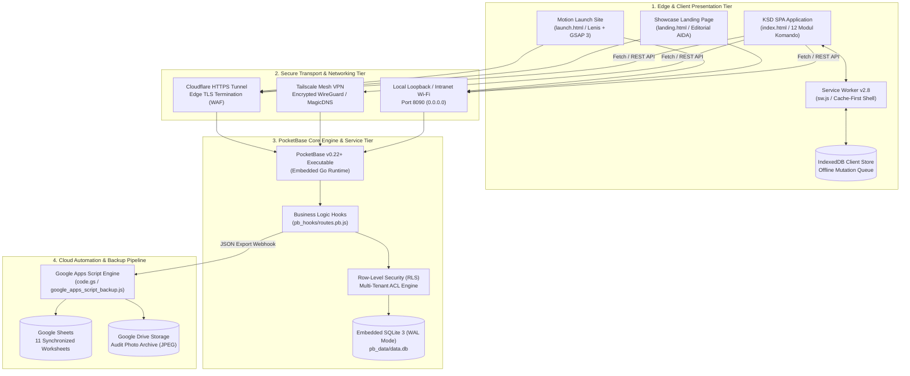
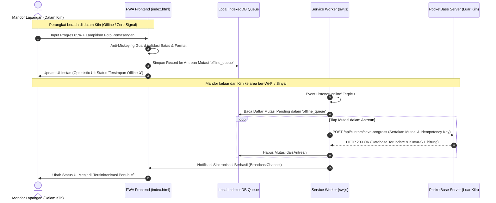

# KSD Monitor — Arsitektur Sistem & Spesifikasi Teknis Terpadu

Dokumen ini mendokumentasikan secara komprehensif arsitektur teknis, model data, mekanisme sinkronisasi offline-first, protokol audit foto mutu 3-tahap, dan komputasi matematis Kurva-S yang mendasari platform **KSD Monitor (TRUNOVA Kiln Shutdown & Overhaul Intelligence)**.

---

## 1. Topologi Arsitektur 4-Lapis (4-Tier System Topology)

KSD Monitor dirancang dengan topologi terdistribusi yang memadukan komputasi edge pada browser lapangan dengan backend Go/SQLite berkinerja tinggi serta pipa pencadangan cloud otomatis tanpa biaya langganan:

---

## 2. Model Data & Skema Database SQLite (`pb_data/data.db`)

Sistem menggunakan SQLite 3 dengan mode *Write-Ahead Logging* (WAL) untuk menjamin konkurensi pembacaan tinggi tanpa memblokir operasi penulisan (*high read concurrency with zero lock-up*).

### Entitas Utama dan Relasinya:

1. **`projects`**:
   - `id` (Text, Primary Key): ID unik proyek (contoh: `proj_kiln3_2026`).
   - `name` (Text): Nama proyek overhaul (contoh: *"Major Overhaul Rotary Kiln #3"*).
   - `kiln_unit` (Text): Identifikasi unit pabrik (`Kiln #1`, `Kiln #2`, `Kiln #3`).
   - `start_date`, `end_date` (DateTime): Tanggal mulai & target selesai.
   - `cooling_hours` (Numeric): Waktu pendinginan kiln sebelum pekerjaan refraktori dimulai.
   - `baseline_locked` (Boolean): Flag pengunci Kurva-S rencana awal.

2. **`master_jobdesks` (IAC - Item Aktivitas Center)**:
   - `id` (Text, PK)
   - `project_id` (Relation &rarr; `projects.id`)
   - `code` (Text): Kode IAC (contoh: `IAC-01`, `IAC-02`).
   - `name` (Text): Area kerja (contoh: *"Burning Zone 0M - 12M"*).
   - `weight_factor` (Float): Bobot persentase total terhadap keseluruhan proyek (\%).

3. **`sub_jobdesks`**:
   - `id` (Text, PK)
   - `jobdesk_id` (Relation &rarr; `master_jobdesks.id`)
   - `title` (Text): Judul pekerjaan spesifik (contoh: *"Pemasangan Bata Magnesite-Spinel 10M"*).
   - `contractor_id` (Relation &rarr; `contractor_pts.id`)
   - `target_volume` (Float): Target meter lari atau tonase.
   - `unit` (Text): Satuan (`m`, `ton`, `pcs`).
   - `planned_progress` (Float): Target progres kumulatif (0 - 100\%).
   - `actual_progress` (Float): Realisasi progres lapangan tervalidasi (0 - 100\%).

4. **`daily_progress`**:
   - `id` (Text, PK)
   - `sub_jobdesk_id` (Relation &rarr; `sub_jobdesks.id`)
   - `entry_date` (Date): Tanggal entri pelaporan.
   - `shift` (Text): Shift kerja (`Shift 1`, `Shift 2`, `Shift 3`).
   - `progress_increment` (Float): Tambahan progres pada hari/shift berjalan.
   - `manpower_count` (Integer): Jumlah personil aktif.
   - `remarks` (Text): Catatan teknis atau kendala lapangan.

5. **`validations` (3-Stage QC Pipeline)**:
   - `id` (Text, PK)
   - `sub_jobdesk_id` (Relation)
   - `stage` (Enum): Tahap inspeksi (`before`, `during`, `after`).
   - `photo_url` (File / Path): Foto resolusi tinggi terkompresi.
   - `inspector_id` (Relation &rarr; `users.id`): Petugas pemeriksa.
   - `status` (Enum): `draft`, `submitted`, `approved`, `rejected`.
   - `inspection_notes` (Text): Hasil pengukuran tebal celah, penguncian hidrolik, dsb.

---

## 3. Arsitektur Offline-First PWA & Antrean Mutasi (Blind-Spot Resilience)

Area kerja di dalam silinder cangkang baja kiln (*kiln shell*) merupakan sangkar Faraday alami yang memblokir sinyal seluler dan Wi-Fi. KSD Monitor mengimplementasikan mesin toleransi luring (*offline resilience engine*) dengan alur:

### Jaminan Keandalan Antrean:
1. **Idempotency Keys**: Setiap entri mutasi diberi UUID v4 lokal. Jika koneksi terputus di tengah proses transmisi, pengiriman ulang tidak akan menduplikasi kalkulasi progres.
2. **Optimistic UI**: Mandor tidak terblokir oleh animasi pemuatan jaringan saat berada di dalam kondisi kerja yang berdebu dan gelap.
3. **Automated Conflict Resolution**: Jika terjadi konflik revisi antara dua mandor pada sub-jobdesk yang sama, sistem menggunakan kebijakan *Last-Verified-By-Inspector-Wins*.

---

## 4. Protokol Audit Foto Mutu 3-Tahap (3-Stage QC Protocol)

Pekerjaan refraktori kiln semen tidak dapat dibongkar ulang setelah operasi *firing restart* berjalan pada suhu >1400°C. Oleh karena itu, bukti visual terverifikasi wajib didokumentasikan dalam 3 tahap mutlak:

| Tahap | Nama Tahap | Deskripsi & Persyaratan Verifikasi |
| :--- | :--- | :--- |
| **01** | `Before` (Pembongkaran) | Foto kondisi bata lama sebelum dibongkar (*demolition*). Mencatat pola keausan, spalling, coating loss, dan ketebalan sisa bata. |
| **02** | `During` (Pemasangan) | Foto proses pemasangan ring bata baru, susunan ekspansi pelat baja (*cardboard/steel shim*), dan kelurusan garis aksial kiln. |
| **03** | `After` (Penguncian / Key Jack) | Foto penguncian cincin akhir (*key bricking*), tekanan dongkrak hidrolik (*jack pressure*), dan pengelasan plat penahan (*retaining ring*). |

Setiap foto yang diunggah melalui komponen *Tactile Camera Dropzone* diproses di memori browser:
- Kompresi canvas proporsional ke ukuran optimal (~500 KB) untuk menghemat kuota transmisi.
- Penyisipan metadata stempel waktu (*timestamp*) dan stempel identitas akun pelapor.
- Hashing SHA-256 lokal untuk verifikasi keaslian berkas di backend.

---

## 5. Formulasi Matematis Kurva-S & Nilai Hasil (EVM)

Perhitungan Kurva-S pada KSD Monitor menggunakan model terintegrasi **Earned Value Management (EVM)** dengan proyeksi trajektori berbasis fungsi kurva logistik (Sigmoid Curve):

### 1. Perhitungan Bobot Kumulatif:
Untuk proyek dengan $N$ Item Aktivitas Center (IAC):

$$\text{Bobot Total Proyek} = \sum_{i=1}^{N} W_i = 100\%$$

Di mana $W_i$ adalah bobot persentase dari IAC ke-$i$. Progres aktual kumulatif pada hari ke-$t$ dihitung dengan rumus:

$$\text{Realisasi Kumulatif}(t) = \sum_{i=1}^{N} \left( W_i \times \frac{\sum_{j=1}^{M_i} P_{i,j}(t)}{M_i} \right)$$

Di mana $M_i$ adalah jumlah sub-jobdesk pada IAC ke-$i$, dan $P_{i,j}(t)$ adalah persentase capaian aktual sub-jobdesk $j$ yang telah disetujui (*approved*) oleh pengawas.

### 2. Metrik Deviasi & Efisiensi:
- **Varians Jadwal (Schedule Variance - SV)**:
  $$SV(t) = \text{Realisasi Aktual}(t) - \text{Target Rencana}(t)$$
  - Jika $SV > 0$: Proyek mengalami percepatan (*Ahead of Schedule* / Signal Green 🟢).
  - Jika $SV < 0$: Proyek mengalami keterlambatan (*Behind Schedule* / Signal Red 🔴).
- **Indeks Kinerja Jadwal (Schedule Performance Index - SPI)**:
  $$SPI(t) = \frac{\text{Realisasi Aktual}(t)}{\text{Target Rencana}(t)}$$
  - Nilai $SPI < 0.90$ secara otomatis memicu peringatan kritis pada bilah telemetri HUD dasbor.

### 3. Proyeksi Trajektori Kurva-S (Sigmoid Formulation):
Kurva rencana ideal dimodelkan menggunakan kurva-S logistik terkalibrasi:

$$P_{\text{plan}}(t) = \frac{100}{1 + e^{-k (t - t_{\text{mid}})}}$$

Di mana $t_{\text{mid}}$ adalah titik tengah durasi shutdown, dan parameter $k$ mengontrol laju akselerasi pekerjaan di fase tengah overhaul.
